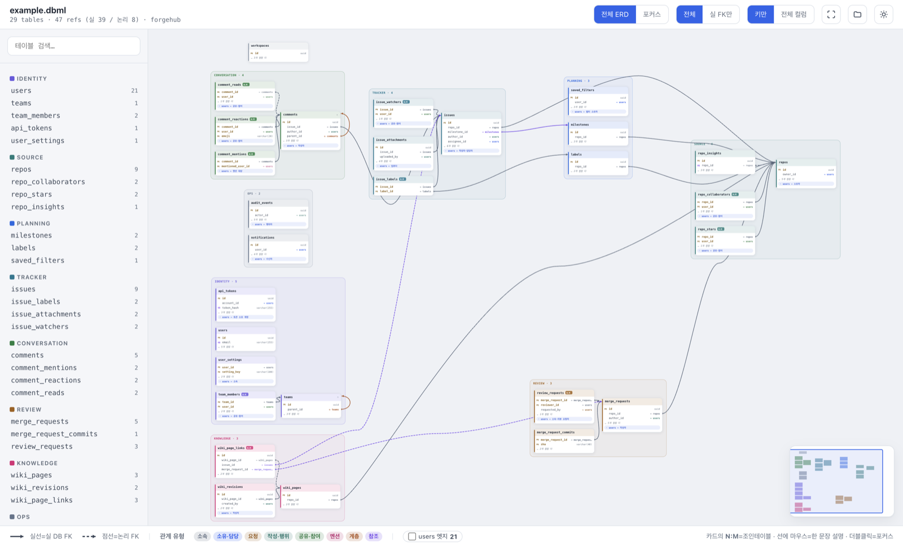
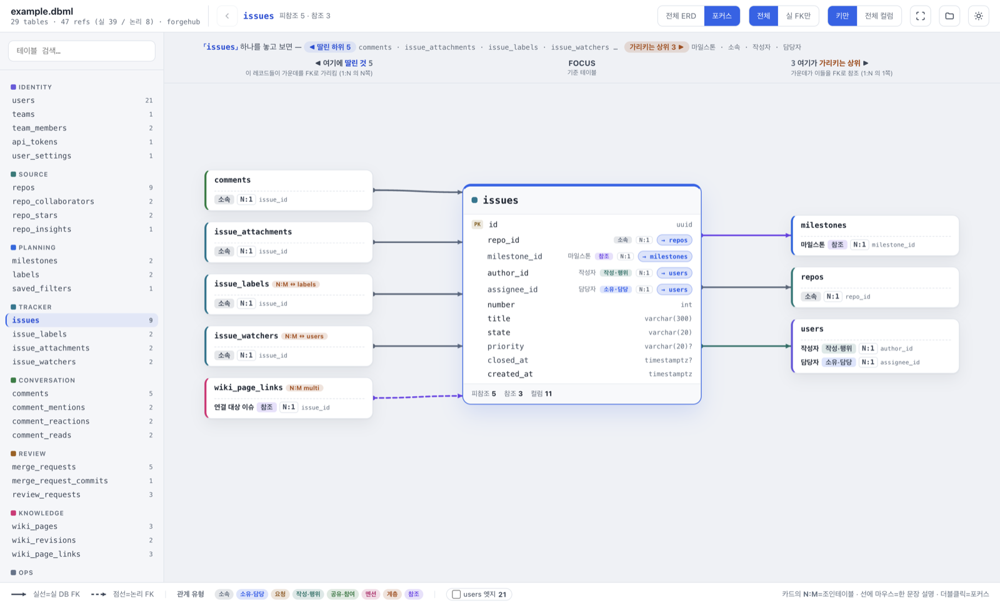

<div align="center">


# schema-lens

A macOS desktop ERD explorer that keeps [DBML](https://dbml.dbdiagram.io/) schemas readable past 20 tables.

See the whole schema as one diagram, walk it one table at a time,
and compare it with your last commit.

</div>

<picture>
  <source media="(prefers-color-scheme: dark)" srcset="docs/erd-dark.png">
  
</picture>

## What it does

| Feature | What it does |
|---|---|
| Full ERD view | Draws every table in one diagram. Tables can be arranged by `TableGroup` cluster, left-to-right flow, top-down flow, or grid, and a minimap shows where you are. |
| Focus mode | Puts one table in the middle, the tables that reference it on the left, and the tables it references on the right. Click a neighbor to move the focus to it. |
| Delete impact | In focus mode, shows what deleting a row of the focused table does: which tables cascade, which columns become `NULL`, and which references block the delete. |
| Compare with last commit | Places the committed schema and your working copy side by side when the file is in a git repository. Added parts are green, removed parts red, and changed parts amber. Open it with `변경 비교` (Compare changes) in the toolbar. |
| Schema library | Keeps a list of every file you have opened, with its table and relationship counts. The list is the start screen, and `⌘L` opens it at any time. |
| Extract DBML from SQL | Converts PostgreSQL or MySQL DDL, such as `pg_dump --schema-only` output, to DBML. It needs no database connection. |
| Live reload | Re-renders the diagram when the open `.dbml` file changes on disk. |
| Screenshot CLI | Renders a schema to a PNG and exits, for visual regression checks. |

<picture>
  <source media="(prefers-color-scheme: dark)" srcset="docs/focus-dark.png">
  
</picture>

## Why it stays readable

Auto-generated ERDs stop being useful at around 20 tables. Every table references `users`,
every edge crosses every other edge, and the real structure is hard to see. schema-lens
handles this in three ways.

- Semantic edge classification. Each foreign key is typed as one of eight relationship kinds
  (composition, ownership, request, authorship, sharing, mention, hierarchy, reference).
  schema-lens infers the kind from column names, `ON DELETE` rules, and primary-key membership.
  Edges stay gray until you hover or select one, and then the edge shows its color and a
  one-sentence explanation.
- Hub folding. schema-lens treats a table as a hub when many tables reference it and most of
  those references are ownership, request, authorship, sharing, or mention relationships, as
  with `users` referenced through `created_by` and `assignee_id`. It hides the hub's incoming
  edges and shows a small chip on each referencing table instead. To show a hub's edges again,
  open the legend with the circled "i" button in the toolbar.
- Routing around tables. Edges run through the gaps between tables and never cross a table.

## Requirements

- macOS 12 or later, on Apple Silicon or Intel (the release is a universal build)
- Node.js 22 to build from source (the version CI uses)
- The UI text is in Korean.

## Install

Download the DMG from the [latest release](https://github.com/HwangBBang/schema-lens/releases/latest)
and drag `schema-lens.app` to Applications.

The app is not signed with an Apple Developer ID, so macOS blocks the first launch of a copy
downloaded with a browser. Remove the quarantine flag once, and the app opens normally after that:

```bash
xattr -dr com.apple.quarantine /Applications/schema-lens.app
```

The [install guide (Korean)](docs/INSTALL.md) has a one-line terminal install that avoids
this block, plus update, uninstall, and troubleshooting steps.

## Shortcuts

| Where | Input and action |
|---|---|
| Anywhere | `⌘O` open a file, `⌘L` schema library, `⌘⇧E` extract DBML from SQL, `⌘R` reload the file |
| Full ERD view, keyboard | `/` search, `0` fit to screen, `Esc` clear the selection |
| Full ERD view, mouse | Click a table to highlight its direct neighbors, double-click to open focus mode, wheel to pan, `⌘` + wheel to zoom, drag a table or a group outline to move it |
| Focus mode | `↑` `↓` move up and down within one side (neighbor tables on the left and right, the focused table's columns in the middle), `Space` preview a neighbor's own relationships, `D` turn delete impact on or off, `⌫` go back, `Esc` close the preview or return to the full ERD |
| Compare view | `0` fit to screen, `Esc` return to the full ERD |

Layout edits are saved per file, and `View > Reset Layout` (`⌘⇧R`) discards them.

## Build from source

```bash
git clone https://github.com/HwangBBang/schema-lens.git
cd schema-lens
npm install
npm start                       # restores the last opened file
npm start assets/example.dbml   # opens the bundled example schema
```

`assets/example.dbml` describes a fictional code-collaboration platform.

## Running tests

```bash
npm run typecheck       # TypeScript type check
npm test                # parser and semantics tests on the example schema and regression fixtures
npm run test:contrast   # WCAG AA contrast check of the light and dark palettes
```

Building the DMG, the npm package layout, and the Screenshot CLI options are described in
[docs/development.md](docs/development.md).

## Writing DBML for schema-lens

Standard DBML works as is. Three optional conventions make the diagram more precise:
a `// logical` comment marks an application-enforced foreign key and draws it dashed,
a short phrase at the start of a column note becomes the edge label, and `TableGroup`
sets the clusters and colors. See [docs/dbml-conventions.md](docs/dbml-conventions.md).

## Architecture

| Path | Role |
| --- | --- |
| `main.ts` | Electron main process: window, menus, file watching, SQL import, reading the last commit |
| `src/parse.ts` | Parses DBML with `@dbml/core` and collects `// logical` markers from the raw text, because the parser drops comments |
| `src/semantics.ts` | Relationship kinds, cardinality, junction tables, hubs, and delete impact. Pure functions shared by the renderer and the tests |
| `src/diff.ts` | Compares two parsed schemas and reports added, removed, and changed tables, columns, and relationships |
| `src/git-baseline.ts` | Reads the last committed version of the open file with `git` |
| `renderer/erd.ts` | Full ERD view: elkjs layout, SVG rendering, edge routing, minimap |
| `renderer/focus.ts` | Focus mode and the delete impact view |
| `renderer/compare.ts` | Side-by-side compare view |
| `renderer/app.ts` | App shell: state, sidebar, toolbar, view switching |
| `renderer/style.css` | Design tokens for both themes |

## License

[MIT](LICENSE) © 2026 HwangBBang
